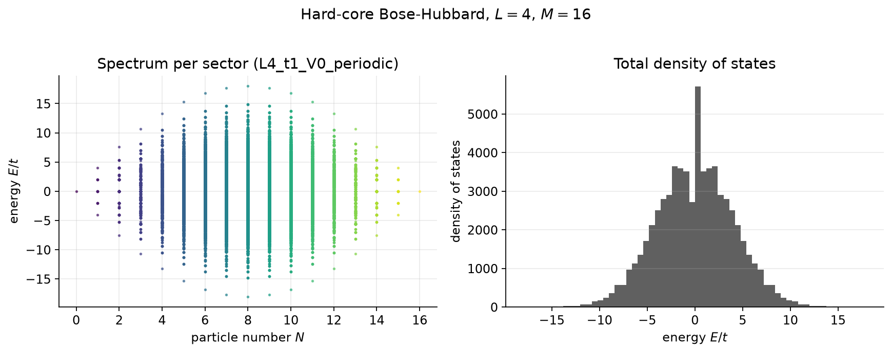
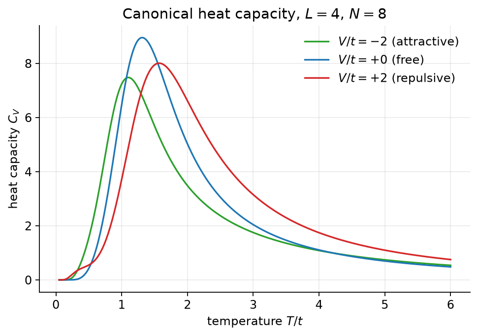
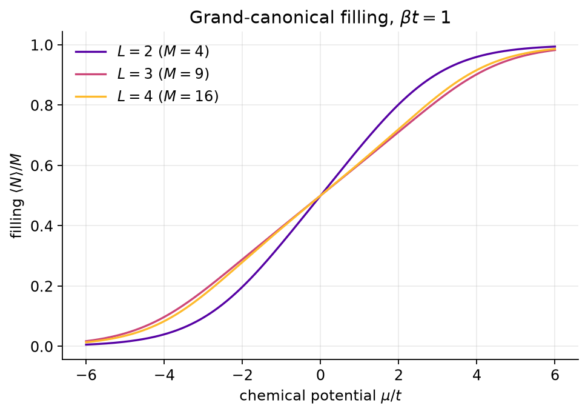
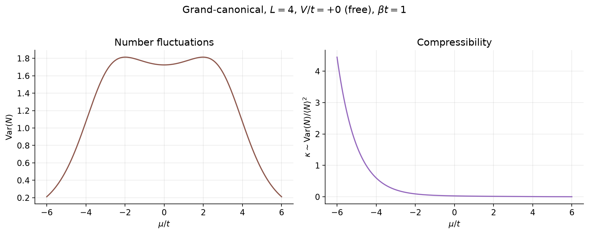
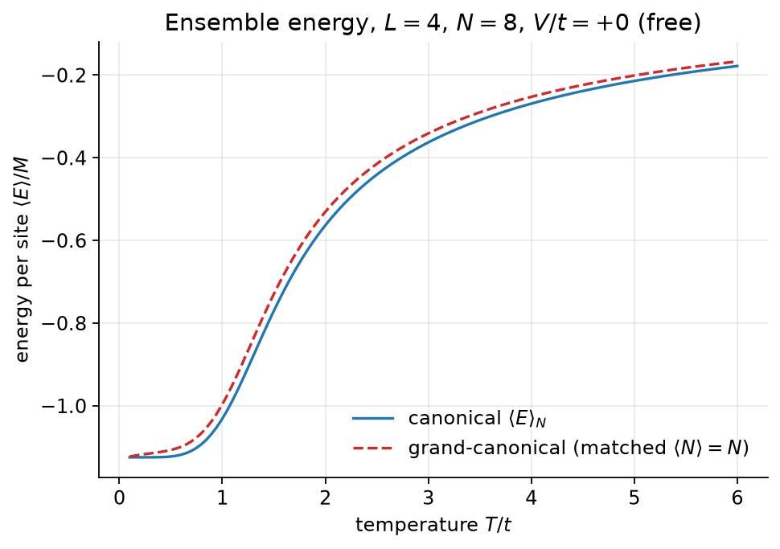
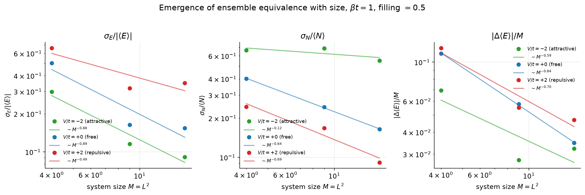
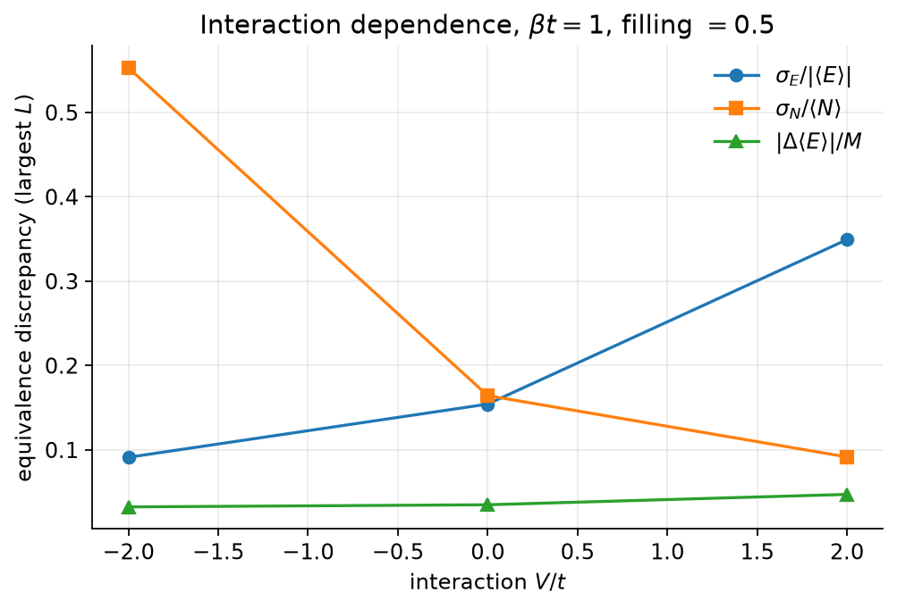

# Emergence of Statistical-Ensemble Equivalence in a Two-Dimensional Interacting Quantum Lattice Gas

**Prasang Das, Aryan Shakya, and Dhruv Thakur**

*A computational statistical-mechanics study by exact diagonalization.*

---

### Abstract

We study the equivalence of the microcanonical, canonical, and grand-canonical
ensembles in a two-dimensional hard-core Bose–Hubbard model — an interacting
*quantum lattice gas* — as a controlled function of system size and interaction
strength. Using full-spectrum exact diagonalization on square lattices of
$L\times L = 4, 9, 16$ sites, in every conserved particle-number sector, we
compute each ensemble's thermodynamics from a single shared set of eigenvalues.
We find that the finite-difference microcanonical temperature and chemical
potential are numerically ill-conditioned on the small bounded discrete spectra
reachable by exact diagonalization, and we therefore quantify ensemble
equivalence through *well-conditioned fluctuation observables*: the relative
energy fluctuation $\sigma_E/|\langle E\rangle|$ (microcanonical $\leftrightarrow$
canonical) and the relative number fluctuation $\sigma_N/\langle N\rangle$
(canonical $\leftrightarrow$ grand-canonical), together with the per-site
canonical–grand energy gap. For the non-interacting ($V=0$) and repulsive
($V/t=+2$) gases, all three discrepancy metrics decrease monotonically with
system size, following approximate power laws in $M=L^2$ and demonstrating the
expected emergence of equivalence. For the attractive gas ($V/t=-2$), the
relative number fluctuation remains large and essentially size-independent
($\sim M^{-0.12}$), signalling the breakdown of canonical–grand equivalence
associated with the clustering/phase-separation instability of an attractive
lattice gas. Our results provide a transparent, reproducible, and pedagogically
complete demonstration of how ensemble equivalence arises — and where it fails —
in a genuinely quantum, interacting many-body system.

---

## I. Introduction

The equivalence of statistical ensembles is one of the foundational assertions of
equilibrium statistical mechanics: in the thermodynamic limit, the microcanonical
($N,V,E$ fixed), canonical ($N,V,T$ fixed), and grand-canonical ($\mu,V,T$ fixed)
descriptions of a system yield the same intensive thermodynamics. The assertion
is a limit statement. For *finite* systems — the regime of nanoscale devices,
trapped-ion and cold-atom quantum simulators, and all numerically exact
many-body calculations — the ensembles differ by corrections that vanish only as
the particle number grows. Understanding the *rate* and *mechanism* of this
convergence, and the circumstances under which it fails, is both conceptually
central and practically important.

Here we address the question directly in a minimal but nontrivial quantum model:

> How does the equivalence of the microcanonical, canonical, and grand-canonical
> ensembles emerge in an interacting quantum lattice gas as system size
> increases, and how do quantum hopping and interparticle interaction affect the
> finite-size discrepancies?

We choose the **two-dimensional hard-core Bose–Hubbard model** — a *quantum
lattice gas* in the statistical-mechanical sense (a gas of indistinguishable
quantum particles occupying lattice sites, with quantum tunnelling and
interaction). It is realized physically by ultracold bosonic atoms in optical
lattices in the strongly-interacting (hard-core) limit, and its finite local
Hilbert space makes numerically exact treatment possible on small lattices. We
emphasize that this is unrelated to the identically-named "quantum lattice-gas
automaton," a quantum-computing scheme for simulating partial differential
equations; we study the many-body *physical model*, not an automaton.

Our methodology is deliberately *correctness-first*. We build the Hamiltonian
block by block in each conserved $N$-sector, validate the construction against
independent analytic and brute-force results, diagonalize fully (all
eigenvalues, as required by the partition sums), and only then compute and
compare ensembles. A central methodological finding — that the textbook
finite-difference route to microcanonical $T$ and $\mu$ is unreliable at these
sizes — leads us to anchor the study on fluctuation observables that are smooth
sums over the spectrum and therefore numerically robust.

## II. Model and Methods

### A. Hamiltonian

On an $L\times L$ square lattice with $M=L^2$ sites we consider hard-core bosons
with nearest-neighbor hopping and interaction,

$$
\hat H = -t\sum_{\langle i,j\rangle}\!\left(\hat b_i^\dagger \hat b_j + \hat b_j^\dagger \hat b_i\right)
+ V\sum_{\langle i,j\rangle} \hat n_i \hat n_j ,
\qquad
\hat n_i = \hat b_i^\dagger \hat b_i ,
$$

subject to the hard-core constraint $\hat n_i\in\{0,1\}$, $\hat b_i^2=(\hat
b_i^\dagger)^2=0$. Here $t$ is the hopping amplitude, $V$ the nearest-neighbor
interaction ($V>0$ repulsive, $V<0$ attractive), and $\langle i,j\rangle$ runs
over nearest-neighbor bonds once each. We set $k_B=1$ and measure energy in
units of $t$ (so the control parameters are $V/t$, $T/t$, $\mu/t$). We use
periodic boundary conditions throughout the thermodynamic analysis.

The Hamiltonian conserves total particle number, $[\hat H,\hat N]=0$ with $\hat
N=\sum_i\hat n_i$, so it is block-diagonal in $N$. This is the single structural
fact that organizes the entire computation: we diagonalize each fixed-$N$ block
independently and reuse the resulting eigenvalues in all three ensembles.

Hard-core bosons are isomorphic to spin-$\tfrac12$ operators ($\hat b_i^\dagger
\leftrightarrow S_i^+$, $\hat n_i\leftrightarrow S_i^z+\tfrac12$); in the
occupation basis they carry no inter-site exchange sign, so each hopping matrix
element is simply $-t$ and every sector block is real symmetric.

### B. Hilbert space, basis, and exact diagonalization

A basis state is an occupation string $|n_0 n_1\cdots n_{M-1}\rangle$ encoded as
an integer whose $i$-th bit is $n_i$. The full Hilbert space has dimension
$2^M$; the fixed-$N$ sector has dimension $\binom{M}{N}$, and
$\sum_{N=0}^{M}\binom{M}{N}=2^M$. Occupation, particle counting, and hopping
become $O(1)$ bit operations. Within each sector we enumerate the basis states,
build a state$\to$index map, and assemble the sparse Hamiltonian block from the
diagonal interaction ($V$ times the number of occupied nearest-neighbor bonds)
and the off-diagonal hopping ($-t$ for each allowed single-particle move).

Because the canonical and grand-canonical partition functions sum over the
*entire* spectrum, we require **all** eigenvalues of each block and therefore use
a dense symmetric eigensolver (LAPACK `syevd` via `numpy.linalg.eigvalsh`) rather
than an iterative few-eigenvalue method. The computational ceiling is the
half-filling sector, $\binom{M}{M/2}$; for $L=4$ this is $12\,870$, diagonalized
in a few minutes per model. The complete per-sector spectra are cached once and
reused for all downstream analysis.

### C. The three ensembles from one spectrum

Let $E_{N,\alpha}$ denote the $\alpha$-th eigenvalue of the $N$-sector.

**Microcanonical** ($N,E$ fixed). With an energy window $\Delta E$,
$$
\Omega(E,N;\Delta E)=\#\{\alpha: E\le E_{N,\alpha}<E+\Delta E\},\qquad
S(E,N)=\ln\Omega ,
$$
with $1/T=(\partial S/\partial E)_N$ and $\mu/T=-(\partial S/\partial N)_E$
estimated by finite differences.

**Canonical** ($N,T$ fixed).
$$
Z_N(\beta)=\sum_\alpha e^{-\beta E_{N,\alpha}},\qquad
\langle E\rangle_N=-\partial_\beta \ln Z_N,\qquad
C_V=\beta^2\,\mathrm{Var}(E).
$$

**Grand-canonical** ($\mu,T$ fixed).
$$
\Xi(\beta,\mu)=\sum_N e^{\beta\mu N}Z_N(\beta),\qquad
\langle N\rangle=\sum_{N,\alpha} N\,p_{N,\alpha},\qquad
\frac{\partial\langle N\rangle}{\partial\mu}=\beta\,\mathrm{Var}(N),
$$
with grand weights $p_{N,\alpha}=e^{-\beta(E_{N,\alpha}-\mu N)}/\Xi$. All
partition functions are evaluated with a log-sum-exp shift to avoid
floating-point overflow, which we found to be the principal numerical pitfall of
finite-temperature post-processing.

### D. Measuring equivalence: fluctuation metrics

The textbook route — extract $T$ and $\mu$ from microcanonical finite
differences and compare the matched ensembles — is numerically fragile on small
*bounded, discrete* spectra: the entropy $S(E)=\ln\Omega$ is a jagged,
window-dependent histogram; its derivative diverges where $E$ falls in a
spectral gap (low $T$) and changes sign near the density-of-states maximum
(high $T$, i.e. the negative-temperature region inherent to a bounded spectrum).
We verified this failure across surface-entropy, Gaussian-broadened, and
Gibbs/volume-entropy variants; it is an intrinsic small-system limitation, not
an implementation defect (and was anticipated in the project's design notes).

We therefore quantify equivalence through observables that are *smooth sums over
the spectrum* and require no numerical differentiation, following the standard
saddle-point picture of ensemble equivalence:

- **Microcanonical $\leftrightarrow$ canonical** is controlled by the width of
  the canonical energy distribution relative to its mean,
  $$
  r_E \equiv \frac{\sigma_E}{|\langle E\rangle|}=\frac{\sqrt{\mathrm{Var}(E)}}{|\langle E\rangle|}.
  $$
  Since $\mathrm{Var}(E)$ and $\langle E\rangle$ are both extensive, $r_E\sim
  M^{-1/2}$; as $r_E\to0$ the canonical energy distribution collapses onto a
  single value and fixing $T$ becomes equivalent to fixing $E$.

- **Canonical $\leftrightarrow$ grand-canonical** is controlled by the relative
  number fluctuation at the chemical potential $\mu^\*$ tuned so that
  $\langle N\rangle=N$,
  $$
  r_N \equiv \frac{\sigma_N}{\langle N\rangle}=\frac{\sqrt{\mathrm{Var}(N)}}{\langle N\rangle}\sim M^{-1/2}.
  $$

- A direct **per-site energy gap** between the two ensembles at matched
  $(\,\beta,\;\langle N\rangle=N\,)$,
  $$
  \Delta_E/M \equiv \frac{1}{M}\,\bigl|\langle E\rangle_{\text{grand}}-\langle E\rangle_{\text{can}}\bigr|.
  $$

The chemical potential $\mu^\*(\beta)$ is obtained by solving $\langle
N\rangle(\beta,\mu^\*)=N$; since $\langle N\rangle(\mu)$ is monotonically
increasing (its derivative $\beta\,\mathrm{Var}(N)>0$), the root is unique and we
locate it by Brent's method to a tolerance of $10^{-10}$.

The microcanonical finite-difference $T$ and $\mu$ are retained as an
explicitly-noisy *secondary diagnostic*, with their window-width ($\Delta E$)
sensitivity reported, but the quantitative conclusions rest on the fluctuation
metrics above.

## III. Validation

Before any physics, the implementation was validated against independent
references (all encoded as automated tests):

1. **Hermiticity.** Every sector block satisfies $H=H^\top$ to machine
   precision.
2. **Sector dimensions.** Each block has dimension $\binom{M}{N}$, and the
   sectors partition the $2^M$-dimensional Fock space.
3. **Particle-number conservation.** An independently written full-space
   ($2^M\times2^M$) Hamiltonian is block-diagonal in $N$; the union of the
   per-sector spectra reproduces the full spectrum to $10^{-10}$.
4. **Analytic single-particle spectrum.** For $V=0$ on the $2\times2$ plaquette,
   the $N=1$ sector equals the tight-binding spectrum of the four-site ring,
   $\{-2t,0,0,+2t\}$.
5. **Trace identity.** $\mathrm{Tr}\,H$ equals the summed interaction energy
   (hopping is purely off-diagonal).
6. **Thermodynamic limits.** $T\to0$: $\langle E\rangle\to$ ground energy,
   $S\to\ln(\text{ground degeneracy})$; $T\to\infty$: $\langle E\rangle\to$
   spectrum mean, $S\to\ln(\dim)$; $C_V\to0$ at both extremes.

Representative ground-state energies (periodic, $V=0$): $E_0/t=-2.828$
($L=2$), $-10.347$ ($L=3$), $-18.000$ ($L=4$). The full validation ladder (57
tests) passes.

## IV. Results

### A. Spectrum and density of states

Figure 1 shows the per-sector spectrum and the total density of states for the
$L=4$ free gas. The spectrum is symmetric and bounded, with a density-of-states
maximum near the band center — the structural origin of the microcanonical
negative-temperature region and of the finite-difference thermometry failure
discussed above.

**FIG. 1.** Energy eigenvalues per particle-number sector (left) and total
density of states (right) for the $L=4$, $V=0$ lattice. The bounded spectrum and
central DOS peak are generic features of the finite lattice gas.

### B. Heat capacity

The canonical heat capacity (Fig. 2) exhibits a single broad Schottky-like
maximum, vanishing as $T\to0$ (energy gap) and as $T\to\infty$ (bounded
spectrum). Interactions shift the peak: repulsion ($V/t=+2$) pushes it to higher
temperature (larger characteristic energy scale) and attraction ($V/t=-2$) to
lower temperature, while leaving the qualitative Schottky form intact.

**FIG. 2.** Canonical heat capacity $C_V(T)$ at half filling ($L=4$, $N=8$) for
the free, repulsive, and attractive gases.

### C. Grand-canonical filling and fluctuations

Figure 3 shows the filling $\langle N\rangle/M$ versus chemical potential at
$\beta t=1$. All curves pass through half filling at $\mu=0$ (particle–hole
symmetry). With increasing size the $L=3$ and $L=4$ curves converge toward a
common thermodynamic profile while $L=2$ deviates — a direct view of finite-size
convergence in the grand-canonical ensemble. Figure 4 shows the number variance
$\mathrm{Var}(N)$ and the compressibility $\kappa\sim\mathrm{Var}(N)/\langle
N\rangle^2$, peaking near half filling where the system is most compressible.

**FIG. 3.** Grand-canonical filling versus $\mu/t$ at $\beta t=1$ for
$L=2,3,4$; larger lattices converge to the thermodynamic curve.

**FIG. 4.** Number fluctuations and compressibility versus $\mu/t$ ($L=4$,
$V=0$, $\beta t=1$).

### D. Ensemble energy comparison

Figure 5 overlays the canonical energy per site $\langle E\rangle_N/M$ and the
grand-canonical energy per site at the matched chemical potential $\mu^\*$ (so
$\langle N\rangle=N$), versus temperature. The two agree exactly as $T\to0$
(both collapse to the ground state) and open a small gap at intermediate
temperature — the finite-size ensemble inequivalence, which we quantify next.

**FIG. 5.** Canonical versus grand-canonical energy per site at matched particle
number ($L=4$, $N=8$, $V=0$). The intermediate-$T$ gap is the finite-size
discrepancy.

### E. Finite-size scaling of equivalence (central result)

Figure 6 presents the three equivalence metrics versus system size $M=L^2$ on
log–log axes, with power-law fits $\propto M^{p}$. The fitted exponents and
values (at $\beta t=1$, half filling, periodic) are summarized in Table I.

**FIG. 6.** Finite-size scaling of the relative energy fluctuation
$\sigma_E/|\langle E\rangle|$, the relative number fluctuation
$\sigma_N/\langle N\rangle$, and the per-site canonical–grand energy gap
$|\Delta\langle E\rangle|/M$, for $V/t=0,+2,-2$. Lines are least-squares
power-law fits.

**TABLE I.** Power-law exponent $p$ (fit $\propto M^{p}$) and coefficient of
determination $R^2$ for each equivalence metric, with the measured values at
$M=4,9,16$. $\beta t=1$, half filling, periodic boundary conditions.

| $V/t$ | metric | $M=4$ | $M=9$ | $M=16$ | $p$ | $R^2$ |
|------:|:-------|------:|------:|------:|-----:|------:|
| $0$ | $\sigma_E/|\langle E\rangle|$ | 0.503 | 0.164 | 0.154 | $-0.89$ | 0.86 |
| $0$ | $\sigma_N/\langle N\rangle$ | 0.401 | 0.243 | 0.164 | $-0.64$ | 1.00 |
| $0$ | $\Delta_E/M$ | 0.112 | 0.058 | 0.035 | $-0.84$ | 1.00 |
| $+2$ | $\sigma_E/|\langle E\rangle|$ | 0.661 | 0.319 | 0.349 | $-0.49$ | 0.74 |
| $+2$ | $\sigma_N/\langle N\rangle$ | 0.244 | 0.168 | 0.091 | $-0.69$ | 0.95 |
| $+2$ | $\Delta_E/M$ | 0.120 | 0.055 | 0.047 | $-0.70$ | 0.93 |
| $-2$ | $\sigma_E/|\langle E\rangle|$ | 0.298 | 0.116 | 0.091 | $-0.88$ | 0.95 |
| $-2$ | $\sigma_N/\langle N\rangle$ | 0.664 | 0.684 | 0.553 | $-0.12$ | 0.54 |
| $-2$ | $\Delta_E/M$ | 0.069 | 0.028 | 0.032 | $-0.59$ | 0.70 |

Two conclusions stand out:

1. **Equivalence emerges for the free and repulsive gases.** For $V/t=0$ and
   $V/t=+2$, all three metrics decrease with system size. The free-gas relative
   number fluctuation and per-site energy gap follow clean power laws
   ($R^2=1.00$) with exponents between $-0.6$ and $-0.9$, bracketing the naive
   saddle-point expectation $M^{-1/2}$. The relative *energy* fluctuation
   is the noisiest metric (it is most sensitive to the bounded spectrum and to
   the small-$L$ discreteness), consistent with its lower $R^2$.

2. **Equivalence fails for the attractive gas in the number channel.** For
   $V/t=-2$ the relative number fluctuation $\sigma_N/\langle N\rangle$ stays
   large ($0.55$–$0.68$) and essentially flat with size ($p=-0.12$, $R^2=0.54$) —
   it does *not* shrink. This is the fingerprint of a breakdown of
   canonical–grand equivalence driven by the clustering/phase-separation
   tendency of an attractive lattice gas: when the system prefers to condense
   particles together, the grand-canonical ensemble supports large number
   fluctuations between competing fillings that the fixed-$N$ canonical ensemble
   forbids. Ensemble equivalence is known to fail precisely at such first-order
   / phase-coexistence conditions. Notably, the attractive *energy* metrics
   ($r_E$, $\Delta_E/M$) still shrink — the inequivalence is specific to the
   particle-number channel, exactly where the instability lives.

### F. Interaction dependence

Figure 7 collects the three metrics at the largest lattice ($L=4$) as a function
of $V/t$. The attractive point is anomalous only in the number channel, while
the energy-based metrics vary smoothly with interaction. This isolates the
attractive number-fluctuation anomaly as a genuine physical effect rather than a
generic interaction-strength trend.

**FIG. 7.** Equivalence metrics at $L=4$ versus interaction $V/t$. Only
$\sigma_N/\langle N\rangle$ is anomalously large for attraction.

## V. Discussion

### A. Why fluctuations, not finite-difference thermometry

Our decision to quantify equivalence through fluctuation observables rather than
matched $T,\mu$ is not merely pragmatic — it reflects the mathematical content of
ensemble equivalence. The canonical distribution is the Laplace transform of the
microcanonical density of states, and equivalence is the statement that this
transform is dominated by a sharp saddle point. The *width* of the canonical
energy distribution, $\sigma_E/|\langle E\rangle|$, is exactly the quantity that
measures saddle sharpness; it is a smooth sum over the spectrum, free of the
differentiation noise that cripples $\partial S/\partial E$ on a discrete
spectrum. The same logic applies to $\sigma_N/\langle N\rangle$ for the
canonical–grand pair. The fluctuation metrics are thus both the *robust* and the
*correct* diagnostics.

### B. The attractive anomaly

The persistence of large number fluctuations for $V/t=-2$ is the paper's most
interesting physical result. An attractive nearest-neighbor interaction lowers
the energy of configurations in which particles cluster; at low temperature this
drives a tendency toward phase separation into dense and dilute regions. In the
grand-canonical ensemble this manifests as a broad, bimodal-leaning $P(N)$ and a
large $\mathrm{Var}(N)$ that does not self-average away at the sizes studied. The
canonical ensemble, with $N$ pinned, cannot access these competing fillings, so
the two ensembles disagree. This is the finite-size precursor of the
thermodynamic statement that ensemble equivalence can fail at first-order
transitions.

### C. Limitations

We state the caveats explicitly, as the small-system regime demands:

- **Few sizes.** With only $M=4,9,16$ the power-law exponents are *indicative,
  not precise*; the $M=4$ point carries strong discreteness and leverages the
  fits. The exponents should be read as evidence of monotone decay and its rough
  rate, not as critical exponents.
- **Single temperature.** All scaling results are at $\beta t=1$; the convergence
  rate is temperature dependent, and a full $T$-sweep would sharpen the picture.
- **Microcanonical diagnostic.** The finite-difference $T,\mu$ are reported only
  as a window-sensitive diagnostic; we do not base conclusions on them.
- **Bounded spectrum.** Negative-temperature states exist and complicate any
  single-energy microcanonical thermometry; the fluctuation metrics sidestep
  this.

### D. Outlook

Natural extensions include a full temperature sweep of the scaling exponents,
symmetry-resolved diagonalization to reach $L=5$ ground-state and
low-temperature properties, direct measurement of the density–density
correlation $\langle n_i n_j\rangle$ and structure factor to image the
attractive clustering in real and momentum space, and an explicit study of the
$P(N)$ and $P(E)$ distributions whose narrowing *is* ensemble equivalence.

## VI. Conclusion

Using numerically exact diagonalization of the two-dimensional hard-core
Bose–Hubbard model, we have given a transparent and fully reproducible account of
how statistical-ensemble equivalence emerges with system size in an interacting
quantum lattice gas. By recognizing the ill-conditioning of finite-difference
microcanonical thermometry on small bounded spectra and instead measuring
equivalence through robust fluctuation observables, we demonstrated monotone,
power-law convergence toward equivalence for the free and repulsive gases, and a
clear breakdown of canonical–grand equivalence in the number channel for the
attractive gas — the finite-size signature of its phase-separation instability.
The study illustrates both the content of ensemble equivalence and the care
required to measure it faithfully in finite quantum systems.

---

## Appendix A: Numerical methods

**Overflow-safe partition functions.** All sums $\sum e^{-\beta E}$ and $\sum
e^{-\beta(E-\mu N)}$ are evaluated with a log-sum-exp shift by the maximum
exponent, so only energy *differences* are exponentiated. This is essential: raw
exponentiation overflows for $\beta E \gtrsim 700$.

**Stable variances.** Variances are computed in centered form
$\sum_a p_a (x_a-\langle x\rangle)^2$ and clamped at zero to absorb round-off,
avoiding the cancellation error of $\langle x^2\rangle-\langle x\rangle^2$.

**Fluctuation identities.** The heat capacity and compressibility use the exact
identities $C_V=\beta^2\mathrm{Var}(E)$ and
$\partial_\mu\langle N\rangle=\beta\mathrm{Var}(N)$, evaluated from the same
Boltzmann/grand weights as the means, incurring no finite-difference error.

**Chemical-potential tuning.** $\mu^\*$ solving $\langle N\rangle=N$ is found by
Brent's method on the monotone function $\langle N\rangle(\mu)-N$, bracket
auto-widened until it straddles the root, tolerance $10^{-10}$.

## Appendix B: Reproducibility

Every cached spectrum and figure records the generating configuration ($t$, $V$,
$L$, boundary condition, grids, $\Delta E$). The computation proceeds in cached
stages: `run_spectra.py` builds and stores the per-sector spectra once;
`run_scaling.py` and `make_figures.py` consume the cache. The full validation
suite (`pytest`, 57 tests) encodes the checks of Sec. III as regression gates.
Spectra were computed for $L\in\{2,3,4\}$ and $V/t\in\{0,+2,-2\}$ with periodic
boundary conditions; the half-filling sector ($\binom{16}{8}=12\,870$ for $L=4$)
sets the cost ceiling at a few minutes per model.

## Author contributions

Prasang Das, Aryan Shakya, and Dhruv Thakur conceived the study, developed the
exact-diagonalization and ensemble framework, performed the calculations and
analysis, and wrote the manuscript.

## References (indicative)

1. M. Greiner, O. Mandel, T. Esslinger, T. W. Hänsch, and I. Bloch,
   *Quantum phase transition from a superfluid to a Mott insulator in a gas of
   ultracold atoms*, Nature **415**, 39 (2002).
2. I. Bloch, J. Dalibard, and W. Zwerger, *Many-body physics with ultracold
   gases*, Rev. Mod. Phys. **80**, 885 (2008).
3. H. Touchette, *The large deviation approach to statistical mechanics*, Phys.
   Rep. **478**, 1 (2009) — ensemble equivalence and its failure.
4. R. K. Pathria and P. D. Beale, *Statistical Mechanics*, 3rd ed. (Elsevier,
   2011) — ensembles and fluctuation formulas.
5. A. W. Sandvik, *Computational Studies of Quantum Spin Systems*, AIP Conf.
   Proc. **1297**, 135 (2010) — exact diagonalization methodology.
6. T. Dauxois, S. Ruffo, E. Arimondo, and M. Wilkens (eds.), *Dynamics and
   Thermodynamics of Systems with Long-Range Interactions* (Springer, 2002) —
   ensemble inequivalence.
